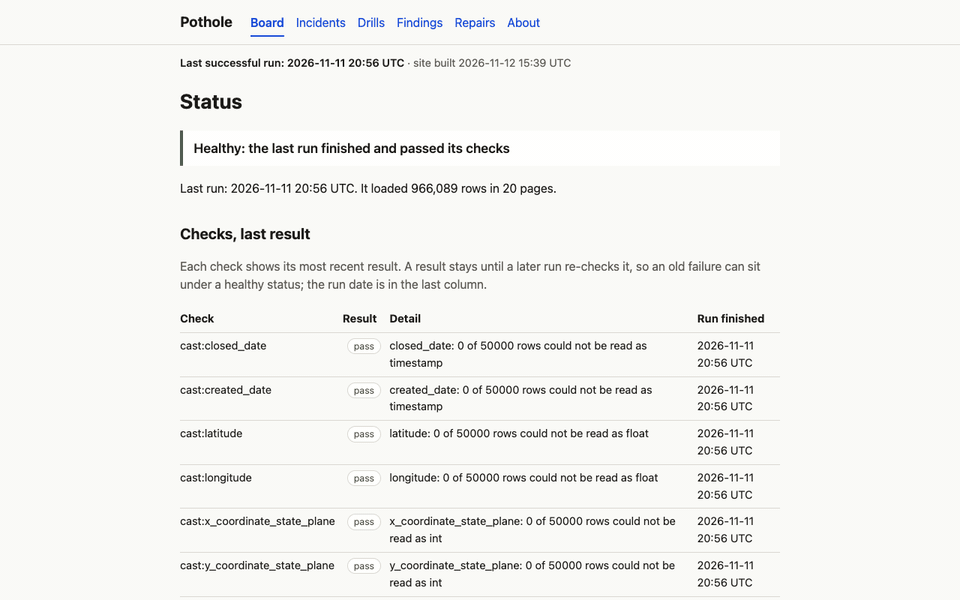

# pothole



*A local build of the site on real NYC 311 data, recorded 2026-11-12. The two days with findings
were analysed after the fact, using data retrieved later for those dates.*

A daily pipeline over public NYC 311 data. It loads and checks each day's rows, has an agent
propose a fix when a check fails, and screens for unusual spikes in complaints.

The site is built by the daily workflow and deployed to GitHub Pages when Pages is enabled for the
repository.

## What it does

- **Loads and checks.** Each day it loads what changed in the last 90 days of NYC 311 service
  requests into a local database and runs checks on the rows (schema, types and values, null rates,
  ranges, freshness, key uniqueness, volume).
- **Repairs, or files an issue.** When a check fails, a repair agent proposes a fix to the pipeline
  spec as a pull request, or opens an issue when the fault is not something a spec edit can fix.
  It is scored on planted faults by a separate deterministic judge, against a rule-based fixer
  that uses no model.
- **Screens for spikes.** A statistical screen picks out district-and-complaint-type counts that are
  unusually high on one day. An AI investigator writes findings with cited evidence and a
  causal-wording filter.


The daily workflow (`.github/workflows/daily.yml`) runs at 11:17 UTC, which is 06:17 in New York in
winter and 07:17 in summer. The model steps run only on the scheduled event and only while the
repository variable `AI_ENABLED` is `true`; a manual dispatch runs without them. Nothing in the
workflow starts, on the schedule or by dispatch, until the repository variable `DAILY_ENABLED` is
`true` (`scripts/setup-repo.sh` sets it to `false`). The site is deployed only while the variable
`PAGES_ENABLED` is `true` as well. This describes how the workflow is
configured. It has not been shown to run unattended for a long period.

## Results

The published repair scores use only the five runs listed in `results/published.json`; other runs
in `results/` are kept as records and are excluded from published scores.

**The test.** There are 30 held-out test cases: 12 faults a spec edit can fix (2 families,
6 cases each), 12 faults it cannot (2 families), 3 volume spikes that need no change, and 3
harmless changes. Each system had one final test run at the frozen commit `d5a3f7d`. The rule-based
fixer had also been scored on the test split earlier, at commit `1a68b34`
(`results/baseline-test/`); that run also scored 6 of 12.

| Repairable faults fixed (test) | Correct |
| :- | :-: |
| Repair agent | 11 of 12 |
| Rule-based fixer | 6 of 12 |

The difference is +41.7 percentage points. A descriptive 95% family-bootstrap interval over whole fault
families (10,000 resamples, seed 7) runs from -16.7 to +100 points. It includes zero, and with only
2 repairable families in the test split it is very wide, so this does not show that the agent is
reliably better. It is a measurement of these 30 cases.

On the same split, both systems handled all 12 faults a spec edit cannot fix correctly (an issue was
the right answer) and left all 3 volume spikes alone, as they should. Those cases are split by who
decided them:

| Test cases | Decided by | Correct |
| :- | :- | :-: |
| 12 repairable faults | agent | 11 of 12 |
| 8 issue cases | agent | 8 of 8 |
| 4 issue cases (source nearly empty) | fixed volume rule | 4 of 4 |
| 3 volume spikes | fixed volume rule | 3 of 3 |

The 3 harmless changes are only checked for being detected, and no one decides them. When the volume
check is the only check that fails, fixed code decides without calling the model: too few rows is an
issue, a high count is no change. Those cases (12 in each dev run, 7 in the test run) are not counted
as the agent's.

Two caveats on the attribution. In the frozen records, an issue the code filed because the model's
submissions were refused was counted as the agent's decision; one of the 20 agent-attributed test
cases is that (the miss below). The code now records such issues as `code`. Also, the cost and time
below are the mean cost and the median elapsed time over the 20 cases the summary attributes to
the repairer, not necessarily 20 model decisions.

| Test run | Mean cost per case | Median time per case |
| :- | :-: | :-: |
| Repair agent | $0.00375 | 15.63 s |
| Rule-based fixer | $0 | 0.09 s |

**The development runs.** Three runs on 42 development cases (18 repairable faults), also at
`d5a3f7d`. These are the cases the system was tuned on, so they say less than the test.

| Dev run | Repairable faults fixed |
| :- | :-: |
| Rule-based fixer | 11 of 18 |
| Repair agent, run a | 17 of 18 |
| Repair agent, run b | 18 of 18 |

**Cost.** The model calls recorded locally while building and evaluating this project settled at
$1.11 as of 12 November 2026 (`data/build_spend.json`, a dated snapshot of the settled total; open
reservations are not included). The ledger itself is a local file that is not in this repository.

## Failures

Three real failures from the build: what happened, and the rule now enforced.

**1. The agent's one miss on the test (`comma_thousands-3`).** The agent's patch was right: it set
the number format to accept thousands separators. The code refused it. The code chose the regression
rows that pin the patch's behaviour, and the rows it chose came out the same with and without
the patch. It then told the model to pick other rows, which the model has no way to do. After
two refusals the code filed an issue instead. The trace is
`results/agent-final-test/traces/comma_thousands-3.json`. Rule now enforced: regression rows must
pass every check on their own, and rows the patch changes come first (`choose_rows` in
`src/pothole/repair/validate.py`). The fix came after the measurement, and the score stays at 11 of
12; the test was not run again.

**2. The investigator's first retrospective run found nothing.** In a local retrospective check
(today's data for two past days), 0 of 4 candidates produced a finding. The model was asked to cite
tool-call ids it was never shown, so every submission was refused. After each tool result was
numbered in what the model sees, a re-run on the same two days gave 4 of 4 accepted findings. These
numbers were recorded locally and cannot be reproduced from this repository. Rule now enforced: a
finding cites the numbered results the model was shown, and the code rejects a citation that does
not match one (`src/pothole/analyst/loop.py`).

**3. An invalid first agent run.** In the first development run the harness gave the repairer a
200-row sample of a 2,000-row batch, so the volume re-check on the patched result always failed and
no patch could pass: 0 of 18 repairs. The run is kept in `results/agent-dev-1/` as a record and is
not scored. Rule now enforced: the repairer sees the same rows its checks were computed on.

## Design decisions

**Three fixed edit operations.** The agent can only point a column at a different source field
(`map_field`), change a column's format (`set_format`) or add a value mapping
(`add_value_mapping`). Anything else is an issue for a person. This keeps every change small enough
to check by running the engine on it.

**The analysis day is run date minus 2.** Counts for a day keep growing for a while after the day
ends. After the last full reload (11 September 2026), 90.8% of a day's rows were in the store one
day later and 97.6% two days later (619,232 rows measured at that lag; `data/delay.json`). That is a
row-weighted historical figure, not a promise that a given morning's data is complete. Lag is
counted in New York calendar days.

**A screen, not a test with a false-alarm guarantee.** Each series is compared with its previous
eight same weekdays (federal holidays left out; series with no baseline or a zero baseline are
skipped) using a negative binomial model whose spread is pooled by complaint type. A count is a
candidate if it is at least 10, at least twice the usual, and passes a Benjamini-Hochberg filter at
0.05. The filter narrows the candidates, and no false-discovery claim is made. On 193 simulated
days with no real events, the share of days with any candidate was 0.5%, 7.8%, 16.6% and 30.1% when
the data was 1, 1.5, 2 and 3 times as spread out as a Poisson count (`data/null_simulation.json`;
the multiples describe the median simulated series). On 30 past days (tested days 7 October to 7 November 2026, using the stored window from 12 August
to 9 November) the screen flagged 0 to 55 series a day, median 2 (`data/backtest.json`). No day there is known to
be a real event, so this is not a calibration. Only the two candidates with the largest ratio are
investigated.

**A 90-day window.** The eight-weekday baseline needs 56 days of history, and leaving holidays out
needs more, so the store keeps 90 days (`pipelines/311.yaml`).

**Volume-only failures are decided by code.** When the only failing check is volume, the model is
not called: low is an issue, high is no change. This assumes a high count is a real rise and not,
say, a load that repeated rows. It is a rule a person can read and test, and it is not the model's
call.

**The site publishes only the listed runs.** `results/published.json` names the five runs above.
The site build refuses to build unless each is finished, was made from a clean checkout, names the
same run id and split in its records, has a recorded commit, records decider counts by run and by
family, and records the decider of each listed failure, and all come from one commit. It does not
recompute scores from the case files. Earlier runs are not mixed in.

## Run it

Install the dependencies (Python 3.12 or 3.13 and [uv](https://docs.astral.sh/uv/)):

```
uv sync --frozen
```

Build the site data from the committed files. This needs no key and no network:

```
uv run pothole demo
```

Then build and preview the site (Node 24):

```
cd web && npm ci && npm run build
npx vite preview     # open http://localhost:4173/pothole/
```

Checks:

```
uv run pytest
uv run ruff check . && uv run ruff format --check .
uv run mypy src
```

The commands that call a model (`eval-repair`, and `daily` with `AI_ENABLED=true`) need an Azure
OpenAI endpoint and key; see `src/pothole/config.py`.

## Limitations

- **Unattended running is configured, not proven.** The workflow is set up to run daily; it has not
  run unattended for long.
- **Scheduled workflows can be switched off.** GitHub documents that scheduled workflows in public
  repositories are disabled after 60 days without repository activity. The workflow commits its own
  results, and this repository has not verified whether those commits count as activity. To turn it
  back on: `gh workflow enable daily.yml`, or use the Actions tab.
- **The faults are planted.** The drills inject faults into recorded days. They are not real
  breakages of the source.
- **Few families.** Each split has only a handful of fault families (2 repairable families in the
  test), so the reported repair-success interval is wide.
- **Source reloads reset `:created_at`.** The arrival-delay figures use only rows filed after the
  last full reload.
- **One tool is shaped by what was seen.** The `value_crosstab` tool was built for the borough
  family that showed up in development.
- **History.** The fault catalog was revised once before any agent run. There were two tuning rounds
  plus defect fixes before the freeze. Runs from before the freeze are kept in `results/` as records
  and excluded from every published score. The rule-based fixer was scored on the test split once
  before the freeze (see Results).
- **A correct patch can become an issue.** A valid patch whose every changed row also fails a check
  on its own is turned into an issue for a person.
- **Investigator wording can be loose.** Citations are checked for being real, not for whether each
  sentence follows from them. In the local re-run, two of the four findings made a comparison with
  no baseline in their cited results (one said "surge").

## License

MIT (see `LICENSE`).

## Data and credits

- **Code:** MIT, in `LICENSE`.
- **311 service requests and permitted events:** NYC Open Data, under the
  [NYC Open Data terms of use](https://www.nyc.gov/html/data/terms.html). The datasets are
  [311 Service Requests from 2010 to Present](https://data.cityofnewyork.us/d/erm2-nwe9) (`erm2-nwe9`)
  and [NYC Permitted Event Information](https://data.cityofnewyork.us/d/tvpp-9vvx) (`tvpp-9vvx`).
- **Weather:** [Open-Meteo](https://open-meteo.com), licensed
  [CC BY 4.0](https://creativecommons.org/licenses/by/4.0/).
- **Map tiles:** [OpenFreeMap](https://openfreemap.org), drawn from
  [OpenStreetMap](https://www.openstreetmap.org/copyright) data under the
  [ODbL](https://opendatacommons.org/licenses/odbl/1-0/).
